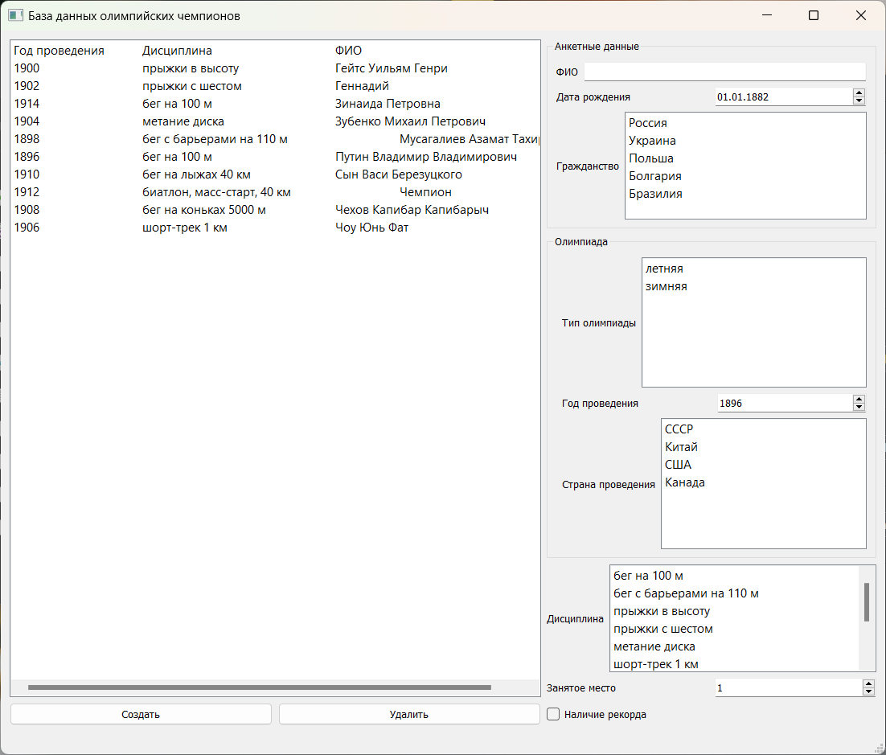

# Baza

Baza — две программы под одним названием. Это сервер, на котором хранятся записи олимпийских чемпионов (фиктивные), и графическая часть, которая выводит эти данные.

## Краткая аннотация

При запуске программы-клиента автоматически запускается сервер. При желании консольное окно сервера можно свернуть, но не закрывать для корректной работы программы. Сервер выполняет базовые логические функции базы данных: сохраняет данные файл, удаляет их, обновляет данные в форме для корректного отображения.

Клиент является видимым отображением и удобным клиентом для взаимодействия с сервером и базой данных.

Все данные введенные в форме, хранятся в файле "okak.txt". Для создания этого файла нужно нажать кнопку "Создать" или "Заполнить". В зависимости от нажатой кнопки появиться запись или записи.

Взаимодействие между клиентом и сервером происходит через каналы.

## Цели и задачи

### Цели проекта
- Демонстрация клиент-серверной архитектуры - показать на практике разделение на серверную (хранение и обработка данных) и клиентскую (интерфейс) части.
- Отработка навыков сетевого взаимодействия — обмен данными между клиентом и сервером через каналы (сокеты/именованные каналы).
- Учебно-демонстрационная цель.

### Задачи проекта
Реализовать сервер, который:
- хранит записи в файле .txt;
- выполняет базовые функции БД: сохранение, удаление, обновление данных;
- передаёт актуальные данные клиенту для корректного отображения.

Реализовать клиент с графической формой:
- ввод и отображение данных;
- удобный интерфейс взаимодействия с сервером.

А также:
- Обеспечить связь клиент–сервер через каналы.
- Реализовать файловое хранение данных без полноценной СУБД.

### Какую бизнес-задачу решал бы этот проект
В бизнес-контексте Baza - это минимальная информационная система учёта для небольшой компании или отдела. Конкретные сценарии:
- Учёт справочных данных - например, каталог сотрудников, клиентов, товаров, контактов. Записи создаются, редактируются, удаляются и отображаются в удобной форме.
- Замена Excel-таблиц - когда нужен простой интерфейс с формами вместо ручного ведения файлов, но без затрат на 1С, CRM или полноценную СУБД.
